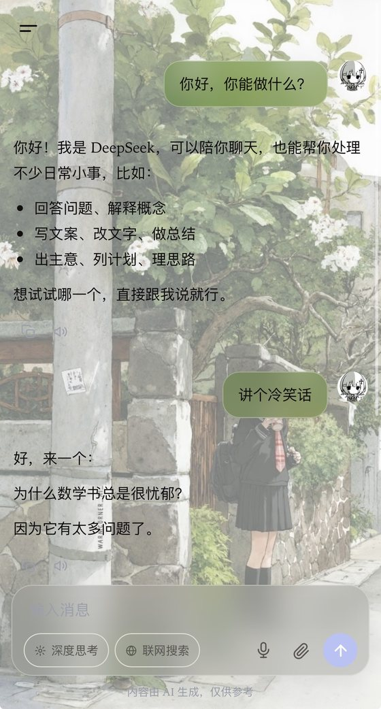
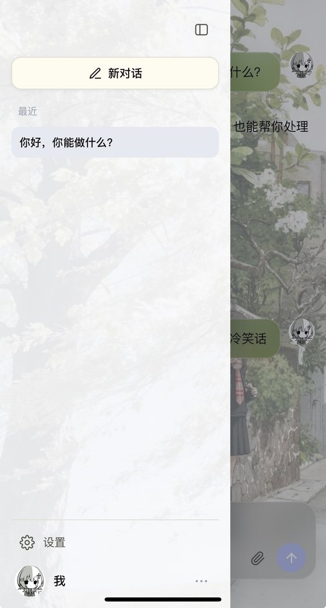
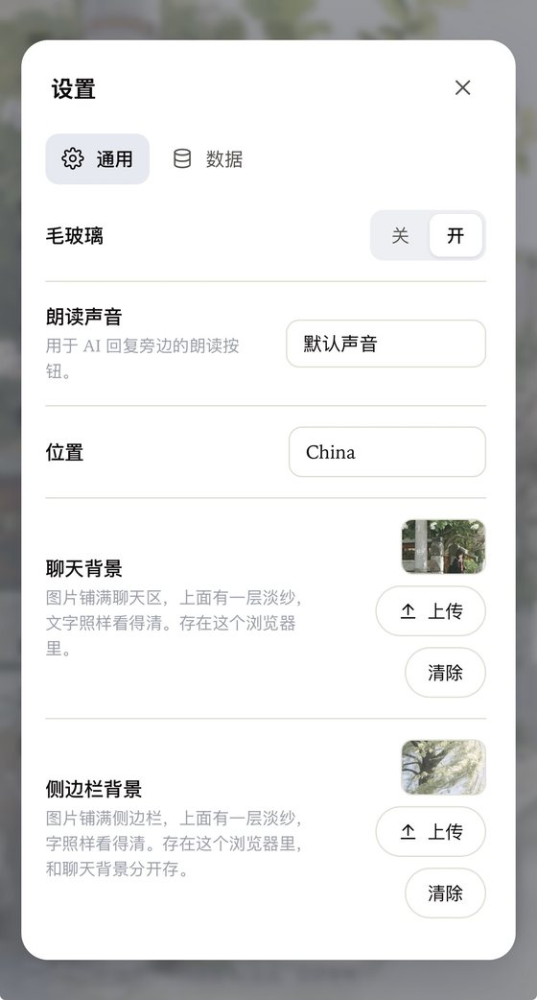
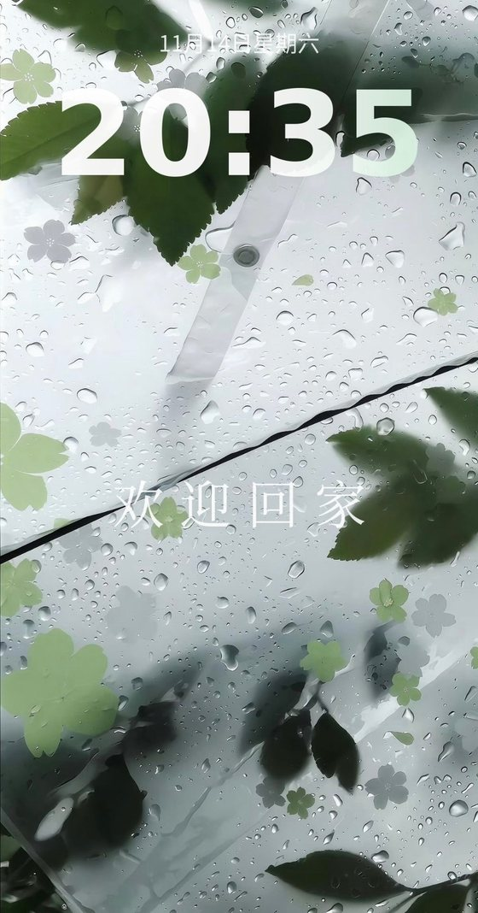
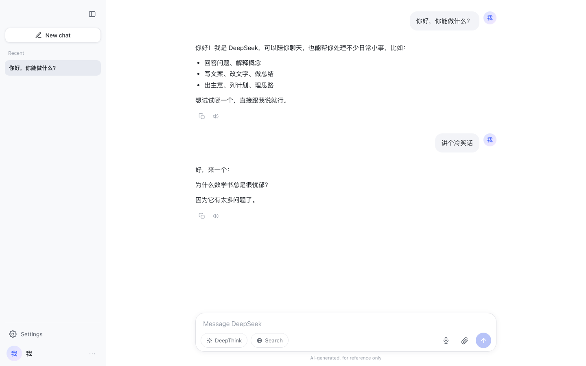
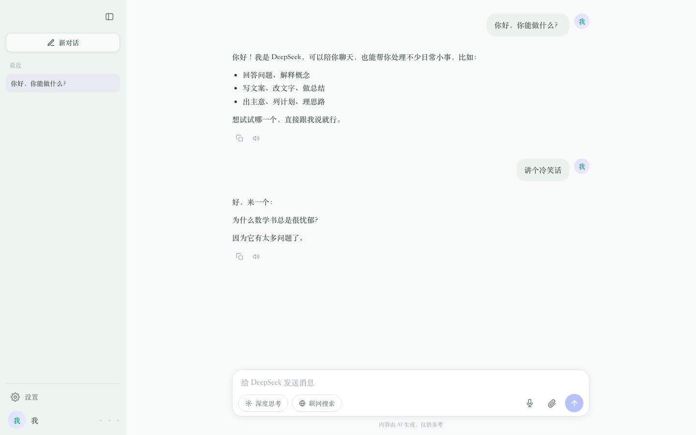

# DeepSeek Chat Skin

一个可以自己换外观的 DeepSeek 聊天界面。单个 HTML 文件，下载后双击就能打开，不用安装、不用后端，手机和电脑都能用。

> 基于 [deepseek-ai/chat-demo](https://github.com/deepseek-ai/chat-demo)（MIT）的界面布局二次开发。**不是 DeepSeek 官方产品**，与 DeepSeek 无关联。

## 界面

上传自己的图片后：

| 聊天界面 | 侧边栏 |
| --- | --- |
|  |  |

| 设置 | 开屏页 |
| --- | --- |
|  |  |

默认外观与配色字体：

| 默认界面 | 配色与字体 |
| --- | --- |
|  |  |

## 功能

- **头像**：点左下角头像换图，自己发的消息旁同步
- **背景**：聊天区与侧边栏各传一张图，互不影响，可随时清除
- **字体**：正文字号小 / 中 / 大；字形系统 / 宋体 / 等宽
- **配色**：5 套预设，点一下切换
- **双方气泡**：默认开，AI 回复和自己的消息都有气泡；关掉后 AI 回复恢复纯文字
- **颜色**：气泡、输入框、强调色各一个取色器，随时改
- **气泡形状**：圆角方 / 圆 / 胶囊，透明度实 / 柔 / 透，描边无 / 细线 / 柔光，宽度窄 / 标准 / 宽；双方同步
- **头像**：圆形或圆角方形，也可以整体隐藏
- **消息间距**：紧凑 / 标准 / 宽松
- **逐句显示**：打开后 AI 回复一句一个气泡，默认整段显示
- **毛玻璃**：开启后气泡与输入框变成半透明磨砂，配背景图更明显
- **柔和光晕**：输入框周围一层淡淡的光
- **薄白纱**：背景上方一层半透明遮罩，明暗主题各一套，保证文字可读
- **明暗主题、中英界面**
- **开屏页**：打开时先显示 `welcome`，文字和图片都能自己换，随后淡出
- **演示对话**：首次打开自带一段示例对话
- **真实对话**：填入自己的 DeepSeek API Key 后可用；Key 只存在当前浏览器，只发给 `api.deepseek.com`

设置保存在浏览器 localStorage，换浏览器或清缓存会重置。

本仓库只包含界面层，不含官方 chat-demo 的完整能力（多分支消息、联网搜索、KaTeX / Mermaid、历史 ZIP 导入导出等）。界面中的「联网搜索」仅为提示词开关，附件只在本地预览。

## 怎么用

1. 仓库右上角 **Code → Download ZIP**，解压。
2. 双击 `index.html`，用 Chrome / Edge / Safari 打开。
3. 头像、背景、字体、配色都在左下角 **设置** 里。
4. 要真的和模型对话：在 [platform.deepseek.com](https://platform.deepseek.com) 申请 API Key，填到 **设置 → 数据**。

不需要 Node.js、npm、构建或服务器。

## 文件

| 文件 | 内容 |
| --- | --- |
| `index.html` | 全部 HTML / CSS / JS，单文件 |
| `LICENSE` | 上游 MIT 许可全文 |
| `docs/screenshots/` | 界面截图 |

样式集中在 `index.html` 的 `<style>`：`--veil` / `--sb-veil` 控制白纱，`--msg-font` 控制字号，`html[data-palette]` 控制配色，`body.tf-*` 控制字体栈，`--bubble` / `--composer-bg` 控制气泡与输入框颜色，`--bubble-radius` / `--bubble-fill` 控制气泡形状，`body.glass` 控制毛玻璃，`#splash` 是开屏页。文案在 `<script>` 的 `I18N` 字典，中英两份。除 `api.deepseek.com` 外没有网络请求；无第三方库、CDN、外部字体或图片，字体走系统字体栈，语音能力由浏览器提供。

## 关于

原项目：[deepseek-ai/chat-demo](https://github.com/deepseek-ai/chat-demo)（MIT，2026-11-13 开源）。作者：[flowwaterrr](https://github.com/flowwaterrr)。

## 许可与免责

原项目版权 `Copyright (c) 2026 DeepSeek`，采用 MIT License；完整文本见 [LICENSE](LICENSE)。本仓库新增部分同样以 MIT License 发布。

- 本项目不是 DeepSeek 官方产品，未获授权或背书；「DeepSeek」名称与品牌归其权利人所有。
- API Key 由使用者自行保管，API 费用与调用风险自负。除 `api.deepseek.com` 外不向任何地址发送内容。
- 软件按「原样」提供，不含任何担保。
