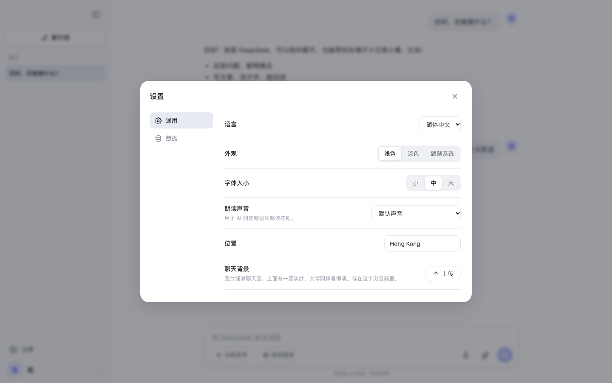
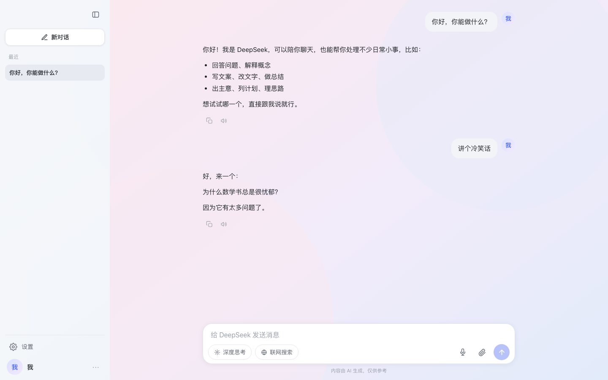

# DeepSeek Chat Skin

一个可以自己换外观的 DeepSeek 聊天界面。单个 HTML 文件，双击就能打开，不用安装、不用后端。

> 基于 [deepseek-ai/chat-demo](https://github.com/deepseek-ai/chat-demo)（MIT）的界面布局做的二次开发版本。**不是 DeepSeek 官方产品**，作者不是 DeepSeek 官方开发者，与 DeepSeek 无合作或背书关系。

## 界面预览

| 默认界面（首次打开自带演示对话） | 设置面板 |
| --- | --- |
|  |  |

## 这个版本改了什么

界面布局和使用体验复刻自官方 demo，代码是重新写的单文件 HTML。在此基础上加了 6 处外观调整：

| 调整 | 怎么用 |
| --- | --- |
| 头像 | 点左下角头像即可换图，自己发的消息旁也会同步；不用改代码 |
| 聊天区背景 | 设置 → 通用 → 聊天背景，上传 / 清除 |
| 侧边栏背景 | 设置 → 通用 → 侧边栏背景，与聊天区互不影响 |
| 正文字号 | 设置 → 通用 → 字体大小，小 / 中 / 大 三档 |
| 薄白纱 | 背景上方一层半透明遮罩，明暗主题各一套，保证文字可读 |
| 演示对话 | 首次打开自带一段示例对话，不会一进来就是空白页 |

所有设置存在当前浏览器的 localStorage，换浏览器或清缓存会重置。

**范围说明**：改的是界面层，不含官方 chat-demo 的完整能力（多分支消息、联网搜索、KaTeX / Mermaid、历史 ZIP 导入导出等）。界面中沿用的「联网搜索」开关只影响提示词，不会真的联网；附件只在本地预览，不会上传给模型。

## 下载和运行（不会代码也能用）

1. 仓库右上角 **Code → Download ZIP**，解压。
2. 双击 `index.html`，用 Chrome / Edge / Safari 打开。
3. 直接就能看到演示对话；换头像、换背景、调字号都在左下角 **设置** 里。
4. 想真的和模型对话：在 [platform.deepseek.com](https://platform.deepseek.com) 申请 API Key，打开 **设置 → 数据** 填入。Key 只存在当前浏览器，只发给 `api.deepseek.com`。

不需要 Node.js、不需要 npm、不需要构建、不需要服务器。

## 继续二次开发

- 本地预览：`python3 -m http.server 8000` → `http://localhost:8000`
- 样式：全部在 `index.html` 的 `<style>` 里；`--veil` / `--sb-veil` 控制白纱，`--msg-font` 控制字号
- 文案：`<script>` 里的 `i18n` 字典，中英两份
- 唯一的外部请求是 `https://api.deepseek.com/chat/completions`。**无第三方库、无 CDN、无外部字体 / 图片**，字体走系统字体栈；语音朗读与输入用浏览器自带 Web Speech API

## 项目来源与改动边界

| | |
| --- | --- |
| 原项目 | [deepseek-ai/chat-demo](https://github.com/deepseek-ai/chat-demo)，2026-11-13 开源，MIT License |
| 本仓库 | 独立新建的二次开发仓库，**不是 fork**，不隶属于 DeepSeek |
| 复刻 | 官方 demo 的整体界面布局与使用体验 |
| 重写 / 新增 | 单文件 HTML 实现；上表 6 项外观调整 |
| 未移植 | 官方 demo 的完整功能集（见「范围说明」） |

作者：[flowwaterrr](https://github.com/flowwaterrr)。

## 鸣谢与许可

感谢 DeepSeek 开源 [chat-demo](https://github.com/deepseek-ai/chat-demo)。原项目版权 `Copyright (c) 2026 DeepSeek`，采用 MIT License；完整许可文本见 [LICENSE](LICENSE)，本仓库已按 MIT 要求保留原版权声明与许可通知。本仓库重写与新增部分同样以 MIT License 发布。

第三方依赖声明：前端零第三方库、零 CDN、零外部字体与图片；运行时仅调用使用者自行配置的 DeepSeek API，语音能力由浏览器提供。上游第三方依赖各自的许可请以[原项目](https://github.com/deepseek-ai/chat-demo)为准。

## 免责声明

- 本项目不是 DeepSeek 官方产品，未获 DeepSeek 官方授权或背书；「DeepSeek」名称与品牌归其权利人所有，此处仅用于说明界面所对接的服务。
- API Key 由使用者自行保管，API 费用与调用风险由使用者承担。本项目不收集数据，除 `api.deepseek.com` 外不向任何地址发送内容。
- 软件按「原样」提供，不含任何担保，详见 MIT License。
